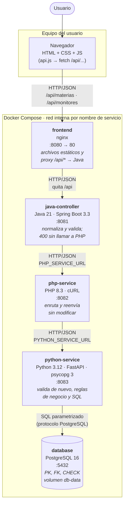

# Diagrama de arquitectura

**Entregable 1 (primera parte).** Componentes del sistema, tecnologías, puertos y responsabilidades,
según `docker-compose.yml` y el [contrato](api-contract.md) (§1, §2 y §9).

La versión para imprimir está en [arquitectura.pdf](arquitectura.pdf). La imagen
[img/arquitectura.png](img/arquitectura.png) se genera desde este diagrama.

Las flechas indican el sentido de las **peticiones**. Cada respuesta regresa por el mismo camino, con el
mismo código y cuerpo (H7).

## Componentes

| Componente | Contenedor | Tecnología | Puerto (host → contenedor) | Responsabilidad |
|------------|------------|------------|----------------------------|-----------------|
| Navegador | — (equipo del usuario) | HTML5, CSS3, JavaScript ES2020 | — | Formularios, tabla y búsqueda; llama solo a rutas relativas `/api/...` (A2) |
| frontend | `monitores-frontend` | nginx (Alpine) | 8080 → 80 | Servir la interfaz y reenviar `/api/*` a Java quitando `/api` |
| java-controller | `monitores-java` | Java 21, Spring Boot 3.3 | 8081 → 8081 | Normalizar (§6.1) y validar (§6.2); responder 400 sin llamar a PHP; propagar la respuesta |
| php-service | `monitores-php` | PHP 8.3, cURL | 8082 → 8082 | Validar ruta, método y JSON; reenviar a Python sin modificar; 502 si Python no responde |
| python-service | `monitores-python` | Python 3.12, FastAPI, psycopg 3, Pydantic v2 | 8083 → 8083 | Validar de nuevo; verificar existencia y duplicados; SQL parametrizado; mapear errores de BD |
| database | `monitores-db` | PostgreSQL 16 (Alpine) | 5432 → 5432 | Persistir materias y monitores con integridad (PK, FK, `CHECK`) |

## Comunicación

| Salto | Protocolo | Dirección interna | Timeout |
|-------|-----------|-------------------|---------|
| Navegador → nginx | HTTP/JSON | `http://localhost:8080/api/...` | — |
| nginx → Java | HTTP/JSON | `http://java-controller:8081` | por defecto de nginx |
| Java → PHP | HTTP/JSON | `http://php-service:8082` (`PHP_SERVICE_URL`) | 3 s conexión, 10 s lectura (T1) |
| PHP → Python | HTTP/JSON | `http://python-service:8083` (`PYTHON_SERVICE_URL`) | 3 s conexión, 10 s lectura (T1) |
| Python → PostgreSQL | Protocolo de PostgreSQL (SQL) | `database:5432` (`DB_HOST`, `DB_PORT`) | 3 s conexión, 5 s por consulta |

## Límites de Docker y red interna

- Los cinco servicios corren en contenedores de **Docker Compose** y comparten la red por defecto del
  proyecto. Dentro de ella se llaman por nombre de servicio (`http://php-service:8082`).
- Desde el equipo solo se usa `http://localhost:8080`. Los demás puertos se publican para depurar y
  probar cada capa (`/health`, Swagger en `:8083/docs`), pero la interfaz **nunca** los usa.
- Solo `python-service` se conecta a la base de datos (A3).
- Orden de arranque con *healthchecks*: database → python-service → php-service → java-controller →
  frontend. Cada servicio espera a que el anterior esté `healthy`.
