# Diagrama de despliegue: tres equipos

Cómo se reparten los componentes del sistema en tres computadores: la **capa de presentación** en uno,
la **capa intermediaria** (PHP) en otro y la **capa de lógica y datos** en un tercero. Los comandos paso
a paso están en [despliegue/README.md](../despliegue/README.md).

```mermaid
flowchart LR
    U(["Usuario<br/>(navegador en cualquier equipo de la red)"])

    subgraph PC1["PC1 · Presentación"]
        direction TB
        NG["<b>frontend</b><br/>nginx + HTML/CSS/JS<br/>:8080 (red)"]
        J["<b>java-controller</b><br/>Java 21 · Spring Boot<br/>:8081 (solo local)"]
        NG -- "HTTP/JSON<br/>/api quitado" --> J
    end

    subgraph PC2["PC2 · Intermediario"]
        P["<b>php-service</b><br/>PHP 8.3 · cURL<br/>:8082 (red)"]
    end

    subgraph PC3["PC3 · Lógica y datos"]
        direction TB
        PY["<b>python-service</b><br/>Python 3.12 · FastAPI<br/>:8083 (red)"]
        DB[("<b>database</b><br/>PostgreSQL 16<br/>:5432 (solo local)")]
        PY -- "SQL parametrizado" --> DB
    end

    U -- "HTTP<br/>http://IP-PC1:8080" --> NG
    J -- "HTTP/JSON por la LAN<br/>PHP_SERVICE_URL" --> P
    P -- "HTTP/JSON por la LAN<br/>PYTHON_SERVICE_URL" --> PY
```

Cada equipo corre Docker Compose con su propio archivo (`despliegue/pc1-presentacion.yml`,
`pc2-intermediario.yml` y `pc3-logica.yml`). Dentro de un equipo, los contenedores se llaman por nombre
de servicio. Entre equipos, se llaman por la IP de la red local.

## Nodos

| Equipo | Capa | Contenedores | Puertos expuestos a la red | Puertos solo locales | Configuración |
|--------|------|--------------|----------------------------|----------------------|---------------|
| PC1 | Presentación | `monitores-frontend`, `monitores-java` | 8080 | 8081 | `PHP_SERVICE_URL=http://<IP-PC2>:8082` |
| PC2 | Intermediario | `monitores-php` | 8082 | — | `PYTHON_SERVICE_URL=http://<IP-PC3>:8083` |
| PC3 | Lógica y datos | `monitores-python`, `monitores-db` | 8083 | 5432 | — |

## Por qué esta distribución

- **Los cortes respetan la cadena del CRUD.** Toda operación sigue la secuencia
  navegador → nginx → Java → PHP → Python → PostgreSQL (A1). Al cortar la cadena en dos puntos, cada
  petición cruza la red **exactamente dos veces**: PC1 → PC2 y PC2 → PC3. Si se agruparan componentes
  no contiguos, una petición iría y volvería entre equipos.
- **Java pertenece a la presentación.** Es el controlador que recibe las solicitudes de la interfaz y
  valida la información básica. Además, nginx le habla por la red interna de Docker sin exponer Java.
- **PHP queda solo**, porque su función es conectar la presentación con la lógica: recibe de Java y
  reenvía a Python sin modificar nada.
- **La base de datos va con Python.** Solo Python se conecta a ella (A3), así que PostgreSQL no necesita
  abrirse a la red: queda publicada solo en `127.0.0.1` del PC3.
- **Solo se abre a la red lo indispensable:** el 8080 para los usuarios, el 8082 para Java y el 8083
  para PHP.

## Qué cambia respecto a correrlo en un solo equipo

| Aspecto | Un equipo (`docker-compose.yml`) | Tres equipos (`despliegue/`) |
|---------|----------------------------------|-------------------------------|
| Dirección de PHP para Java | `http://php-service:8082` | `http://<IP-PC2>:8082` |
| Dirección de Python para PHP | `http://python-service:8083` | `http://<IP-PC3>:8083` |
| Orden de arranque | Automático (`depends_on` con healthchecks) | Manual: PC3 → PC2 → PC1 |
| Puertos de Java y PostgreSQL | Publicados en el equipo | Solo locales (`127.0.0.1`) |
| Firewall | No aplica | Abrir 8080 (PC1), 8082 (PC2) y 8083 (PC3) |
| Código de los servicios | — | **Sin cambios**: cada servicio lee la dirección del siguiente de una variable de entorno |

La única modificación en el código fue en la interfaz: `frontend/nginx.conf.template` toma la dirección
de Java de `JAVA_SERVICE_URL`, con `http://java-controller:8081` por defecto. Así, nginx tampoco tiene
direcciones fijas.

## Qué indica cada error en el despliegue distribuido

Los errores del contrato señalan directamente qué equipo o qué conexión falla:

| Respuesta en la interfaz | Equipo o conexión que falla |
|--------------------------|-----------------------------|
| `No se pudo conectar con el servidor` | El navegador no alcanza al PC1 |
| `502 Servicio PHP no disponible` (E15) | Conexión PC1 → PC2, o PHP caído |
| `502 Servicio de persistencia no disponible` (E16) | Conexión PC2 → PC3, o Python caído |
| `503 Base de datos no disponible` (E17) | PostgreSQL caído dentro del PC3 |

## Verificación

Se levantaron los tres archivos en un mismo equipo, como tres proyectos de Compose independientes que se
comunican por la IP de red del equipo, igual que entre computadores:

- **Smoke test:** 14 pasos correctos y 1 omitido. Omite la revisión de los logs de PHP porque PHP corre
  en otro equipo.
- **Colección de Postman por la entrada pública:** los mismos resultados que en un solo equipo (ver
  [endpoints.md](endpoints.md#verificación)).
- **Exposición:** PHP (8082) y Python (8083) responden por la IP de red; Java (8081) y PostgreSQL (5432)
  no son accesibles desde ella.
