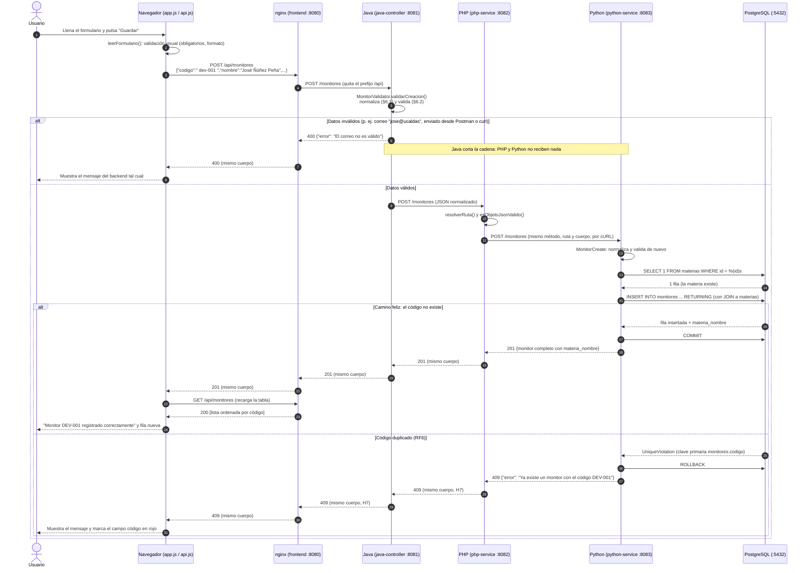

# Diagrama de secuencia: registro de un monitor (RF1)

**Entregable 2.** Recorrido completo de `POST /api/monitores`, desde que el usuario pulsa **Guardar**
hasta que el monitor aparece en la tabla. Incluye las dos alternativas que exige el contrato: datos
inválidos (Java responde 400 sin llamar a PHP) y código duplicado (PostgreSQL → Python 409 → se
propaga).

La imagen [img/secuencia-registro.png](img/secuencia-registro.png) se genera desde este diagrama.

## Petición de ejemplo

```http
POST /api/monitores HTTP/1.1
Host: localhost:8080
Content-Type: application/json

{"codigo": " dev-001 ", "nombre": "José  Ñúñez Peña", "correo": "Jose.Nunez@UCaldas.edu.co", "materia_id": 1}
```

Java y Python normalizan el cuerpo (§6.1) antes de validarlo. Se guarda como
`{"codigo": "DEV-001", "nombre": "José Ñúñez Peña", "correo": "jose.nunez@ucaldas.edu.co", "materia_id": 1}`.

Respuesta `201 Created` (`Content-Type: application/json; charset=utf-8`):

```json
{"codigo": "DEV-001", "nombre": "José Ñúñez Peña", "correo": "jose.nunez@ucaldas.edu.co", "materia_id": 1, "materia_nombre": "Ingeniería de Software III"}
```

## Diagrama



## Explicación de los pasos

| Pasos | Qué pasa | Dónde está en el código |
|-------|----------|-------------------------|
| 1–3 | La interfaz valida lo básico y envía el JSON a la ruta relativa `/api/monitores` (A2) | `frontend/app.js` (`guardarMonitor`, `leerFormulario`), `frontend/api.js` (`crearMonitor`) |
| 4 | nginx reenvía a Java quitando `/api` | `frontend/nginx.conf` (`location /api/`) |
| 5 | Java normaliza y valida en el orden del §6.3 | `java-controller/.../validation/MonitorValidator.java` |
| 6–8 | Alternativa 400: Java responde el primer error y **corta la cadena** | `java-controller/.../exception/GlobalExceptionHandler.java` |
| 9–11 | PHP comprueba ruta, método y JSON, y reenvía sin modificar | `php-service/index.php`, `php-service/PythonClient.php` |
| 12–15 | Python valida de nuevo, comprueba que la materia exista (si no, 400 E10) e inserta | `python-service/main.py`, `schemas.py`, `repository.py` |
| 16–24 | Camino feliz: commit, 201 de vuelta por la misma cadena y recarga de la tabla | `python-service/db.py` (`get_connection`), `frontend/app.js` (`cargarMonitores`) |
| 25–31 | Alternativa 409: PostgreSQL rechaza la clave primaria repetida, Python hace *rollback* y responde 409 (E12), y PHP y Java lo propagan sin cambiarlo | `python-service/main.py` (captura `UniqueViolation`) |

**Notas**

- **Orden de validación de Python (§6.3, pasos 7 y 8).** Python consulta primero si la materia existe
  y después inserta. Así, si el código está repetido **y** la materia no existe, gana el 400 de materia,
  como exige el contrato. PostgreSQL, por sí solo, revisaría antes la clave primaria.
- **De dónde viene el 400 de Java.** Desde la interfaz es poco común, porque `app.js` aplica las mismas
  reglas antes de enviar (captura de validación en el documento final). Aparece cuando la petición llega
  directamente a la API, como en la colección de Postman ([endpoints.md](endpoints.md)).
- **Si un servicio de la cadena no responde,** la respuesta es 502 (`Servicio PHP no disponible` o
  `Servicio de persistencia no disponible`) o 503 si la caída es de la base de datos (`Base de datos no
  disponible`). Esos casos se describen en [endpoints.md](endpoints.md#5-catálogo-de-errores-e01e18).
